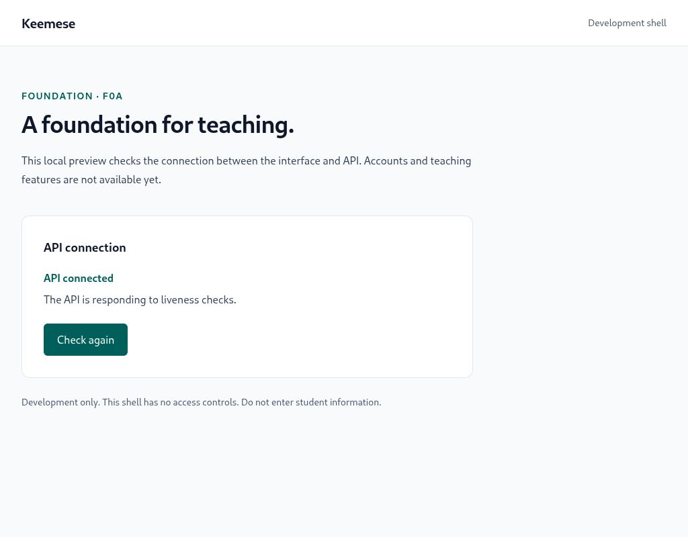

# Keemese

**A focused teaching workspace for one tutor and their students.**


[Quick start](#prerequisites) · [Local preview](#run-locally) · [Verification](docs/testing/evidence/f0a.md) · [Project docs](docs/README.md) · [Roadmap](docs/delivery/plan.md)

## At a glance

| Available now | Next foundation packet | Planned teaching workspace |
|---|---|---|
| .NET API liveness and HTTP integration tests | Disposable PostgreSQL integration (F0b, approved for the next packet) | Tutor-created student accounts and isolated student activity |
| React shell with connection status and retry | Real database round-trip and rollback checks | Reusable content, lesson plans, assignments and private notes |
| Exact dependency pins, locks and reproducible setup | Test-owned resource cleanup | Teaching workflows follow their own approval gates |

Badges describe the pinned stack, not live CI or deployment status. Current verification evidence is linked above.

<details>
<summary><strong>Preview the current development shell</strong></summary>



*F0a local preview. Teaching workflows are not implemented yet.*

</details>

## Current scope

F0a development skeleton for a private teaching workspace. Only an API liveness endpoint and a connection-status shell exist. There is no authentication, database, student data or teaching workflow. Do not expose these development servers publicly or enter student information. F0 remains incomplete until F0b passes.

## Prerequisites

Use .NET SDK **10.0.403** (includes ASP.NET runtime 10.0.14), Node **24.22.1**, and npm **11.19.1**. `global.json` requires the exact SDK; `frontend/.nvmrc`, package engines and `.npmrc` identify/enforce the tested Node/npm versions. If using nvm, activate the already-installed version with `nvm use 24.22.1` before running npm. No global installation is part of this packet.

## Restore and verify

From repository root:

```sh
dotnet restore Keemese.slnx --locked-mode
dotnet build Keemese.slnx --no-restore
dotnet test Keemese.slnx --no-build
cd frontend
npm ci
npm run typecheck
npm run build
cd ..
```

NuGet `packages.lock.json` files and npm `package-lock.json` pin the resolved graph. Direct package versions are exact; intentional dependency changes require regenerating and reviewing locks. Normal restores populate user caches. On a first .NET invocation, the SDK may initialize local state and create an untrusted development HTTPS certificate; this application does not need or trust it. No environment file or secret is needed for F0a.

## Run locally

Terminal 1, repository root:

```sh
dotnet run --project backend/Keemese.Api --no-build --no-launch-profile --urls http://127.0.0.1:5080
```

Terminal 2, repository root:

```sh
cd frontend
npm run dev
```

Open [the development shell](http://127.0.0.1:5173). It should show **API connected**. Stop the API with Ctrl+C and choose **Check again** to see **API unavailable**; restart the API and retry to recover. A request times out after five seconds. The status is a point-in-time check, not continuous monitoring. The shell makes same-origin `/api/v1/health/live` requests; Vite proxies `/api` to loopback port 5080. Both servers bind to loopback; occupied frontend ports fail rather than silently changing. No broad CORS policy is needed.

For a built-asset smoke test, run `npm run preview` from `frontend` after building and open [the local preview](http://127.0.0.1:4173). Preview uses the same API proxy. Vite dev/preview are local tools, not a production hosting design. Stop each server with Ctrl+C when finished.

Optional direct HTTP check while API runs:

```sh
curl --fail --include http://127.0.0.1:5080/api/v1/health/live
```

Expected: HTTP 200, JSON content type, body `{"status":"ok"}`. Liveness proves that the process answers HTTP; it does not claim database readiness or access protection. Integration tests boot the actual entry point through ASP.NET `WebApplicationFactory` and check the response contract, absent student route (404), and rejected POST (405). They do not use a database.

## Scope and evidence

See [delivery plan](docs/delivery/plan.md), [verification strategy](docs/testing/strategy.md), [current checkpoint](harness/state/progress.json), and [build log](harness/logs/build-log.md). Current implementation commands above supersede the earlier planning-only command placeholders. Linux is the verified environment; other OS/browser combinations remain unverified.
