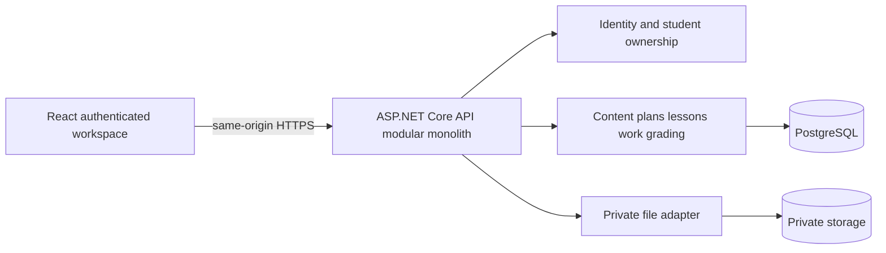

# Architecture and domain design

Status: proposed, pending review. Requirements: P01–P38, P42, P52. Decisions: [ADR01–03](../decisions/decisions.md). Security and APIs have [separate owners](../README.md).

## Deployment and module boundaries



One deployable API and one database avoid distributed transactions and needless operations. Suggested source layout when approved: backend host, module directories, infrastructure adapters and narrowly shared primitives; frontend routes/features/components. Do not generate a project per entity or generic repository wrappers. Modules own writes; cross-module operations use explicit application services/IDs, not arbitrary writes to each other's tables. One transaction can span modules for the after-lesson use case. Domain behavior remains testable without HTTP/storage.

| Module | Owns | Boundary |
|---|---|---|
| Identity | Users, credentials, roles, sessions, resets | Provision/revoke; no public creation |
| Students | Profile, contacts, strengths/needs, status | One profile per student user |
| Content | Folders, items, lesson definitions, materials, question bank | Tutor-owned reusable sources |
| LearningPlans | Goals, metric definitions/values, plans/items | Student-specific order and lifecycle |
| Lessons | Sessions, attendance, session material references | Scheduled occurrence distinct from reusable lesson |
| Assignments | Assignment definitions, assigned work, submissions | Own deadline, attempts and answers per student |
| Assessments | Definitions/sections, assigned tests and timed attempts | Own timing, scoring and release |
| Feedback/Progress | Review records; read projections and manual metrics | Computed progress derived from authoritative activities |
| Notes | Private note links and content | Tutor-only read/write |

Share pure question-validation/scoring primitives between assignments and assessments, not their entire lifecycle. Notifications remain deferred; no queue/broker/outbox until a real delivery requirement warrants it. No multi-tenant partition, Redis, microservices or event bus initially.

## Relational model proposal

All mutable entities use UUID ID, UTC created/updated timestamps, actor IDs where meaningful and an explicit concurrency version. IDs are not authorization. Student-owned rows carry student_id, even when derivable, with composite constraints where needed to reject cross-student links. Exact migrations are deferred.

| Tables / relationships | Constraints and indexes |
|---|---|
| users → student_profiles (1:0..1) | Unique normalized username; role check; enforce single tutor provisioning invariant; unique profile user_id; status index |
| student_contacts → profile | Optional phone/email/guardian data; no guardian login; minimum retained fields |
| metric_definitions → goal/metric_values; student_goals → profile | Metric kind/unit/range configurable; values compatible with definition; index (student_id, recorded_at) |
| learning_plans → student; plan_items → plan, optional parent/item reference | No cycles; ordered siblings; explicit priority/state; cross-student references forbidden; order updates transactional |
| content_folders → parent; content_items → folder | No folder cycles; title/type required; indexed folder, normalized title; tags join table, not fixed enums for exam names |
| materials → content/file metadata; material_grants → student/context | Private opaque storage key, size/hash/MIME/status; unique grant scope; file bytes outside DB |
| lesson_definitions → content; lesson_sessions → student, optional definition | start UTC + IANA timezone + duration; end after start; index (student_id,start_at), tutor schedule index |
| attendance → session | One record/session; attendance separate from cancellation/rescheduling status |
| questions → options/tags/attachments | Discriminated type and validated configuration; points nonnegative; answer keys never returned by student source routes |
| assignment_definitions → definition_questions; student_assignments → student, definition snapshot | Independent deadline/status; snapshot immutable once assigned; student/status/due index |
| assignment_submissions → student_assignment; answers → submission, snapshot question | Unique attempt ordinal; enforce matching student/question ownership; append submitted history |
| assessment_definitions → sections → questions; student_assessments → student, snapshot | Ordered sections; scoring/time rules validated before assignment |
| assessment_attempts → student_assessment; attempt_answers → attempt | Unique attempt number; start/expiry stored server-side; submission idempotent |
| grade_reviews / feedback → submission or attempt | Explicit target type/id, not an unconstrained arbitrary foreign key; score bounds, reviewer, revision, publication timestamp |
| teacher_notes → student and optional typed session/work target | Tutor-only; no accidental inclusion through generic serializers |
| audit_entries | Actor/action/target/time/correlation, minimal metadata; no passwords or raw answer content in logs |

Use normalized columns for ownership, state, scheduling, scores and relations. JSONB is limited to versioned typed question/configuration/metric metadata with validation; do not build an unrestricted EAV system. Prefer queryable structured data over accepting arbitrary fields everywhere. Foreign keys restrict destructive deletion of referenced history. Archive used definitions; hard-delete unused drafts only; retention/purge requires D04. No automatic cascading deletion of submissions when a source question is deleted.

## Lifecycle and integrity

| Aggregate | Proposed transitions / invariants |
|---|---|
| Student | active ↔ inactive → archived; deactivate revokes sessions, retains history |
| Content/question/definition | draft → ready → archived; editing source does not mutate assigned snapshot |
| Plan/item | planned → active ↔ paused → completed; reopening is explicit and audited |
| Session | scheduled → completed / cancelled / absent / rescheduled; reschedule retains link/history, attendance recorded independently |
| Student assignment | assigned → in_progress → submitted → graded → released; overdue derived from deadline, not a terminal state |
| Assessment attempt | in_progress → submitted or expired → grading → graded → released; server clock owns expiry; recovery cannot create a duplicate attempt |
| Material | pending → validated → available / rejected → archived; no serving pending/rejected objects |

Reopen/retry and publication rules need D02 approval. Submission uses transaction + idempotency key; optimistic concurrency rejects stale tutor edits with 409 and preserves draft in UI. Automatic scores plus manual components yield pending total until review completes. Pass/fail is calculated on a documented scale; no TOEIC/IELTS conversion built into code. Changing scores retains audit revision. Snapshot schema versions support integrity without promising a full version editor.

Progress initially uses SQL/read-service queries, not a separate event-sourced store: assignments completed/eligible, attendance completed/eligible, goal status, score series labeled with scale and assessment identity. Cancelled sessions and archived work require explicit denominator rules (D07). Avoid averaging unrelated tests. Manual teacher observations are separately labeled.

## Critical transactions and diagrams

```mermaid
sequenceDiagram
  participant T as Tutor
  participant A as API
  participant D as Database
  T->>A: Complete session + private note + material + homework (version/key)
  A->>A: Authenticate tutor; validate links and snapshot
  A->>D: Transaction: session, note, grants, assigned work, audit
  D-->>A: Commit or rollback
  A-->>T: Saved summary or actionable conflict/error
```

Uploads precede this transaction; attaching a validated file is transactional metadata only. Orphaned uploads need a bounded cleanup policy after D04; do not pretend file store and database share a transaction. Recovery and reconciliation are documented in the [runbook](../operations/runbook.md).
